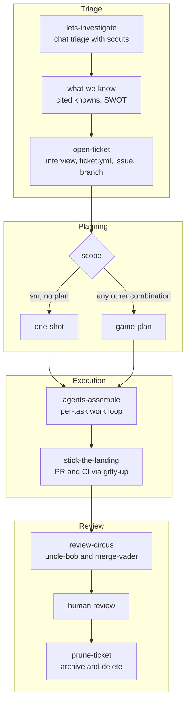
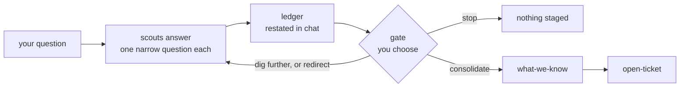
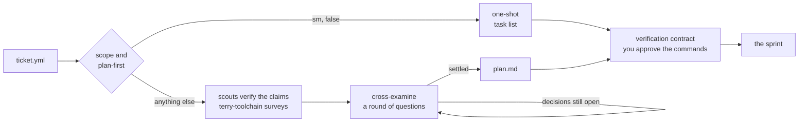
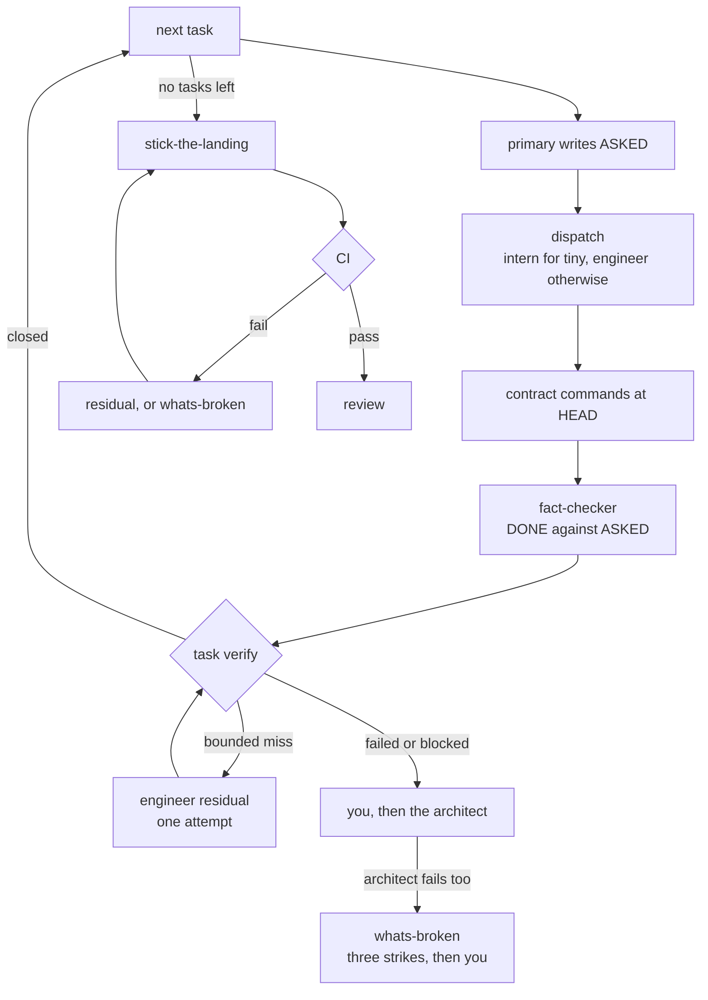
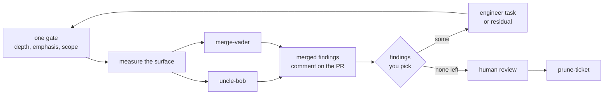

# mightymodels

mightymodels takes a piece of work from the first question you ask a model to a merged PR. You make the decisions, and nothing is called done until a command proves it.

Each piece of work gets one `.mightymodels/<slug>/` directory and one `ticket.yml` carrying its scope and model routing. When the work merges, `/prune-ticket` compresses the directory into a 30-line archive and deletes it. The unit of deletion is the unit of work, which is what stops working state from turning into a landfill of stale evidence.

The plugin ships nineteen skills, twelve worker agents, seven hooks and one MCP server that holds the state.

## The Problem It Solves

mightymodels is built from the failures of spec-driven development. It is oriented around human-in-the-loop decision making, and it is the plugin I cannot live without. It has cut my token consumption, the model gets more of the work right, and it has changed the way I work with AI.

I have no numbers for any of that yet. I plan to evaluate this release aggressively over the coming days, and what I measure will go here.

Each row is a way agent work goes wrong, and what the loop does about it.

| What goes wrong | What mightymodels does |
| ---------------------------------------------------------------------------- | --------------------------------------------------------------------------------------------------------------------------------------------------------------------------------------- |
| A plan written up front goes stale as the code moves. | `plan.md` is a ledger of invariants, tasks, non-goals and risks, deliberately free of code citations. Citations are gathered fresh for each task, at the moment it starts. |
| The agent makes a decision that was yours to make. | Facts go to scouts and decisions go to you. Investigation rounds stop at a gate, the plan needs your approval before any dispatch, and no review finding is fixed unless you picked it. |
| "Done" is a claim nobody checked. | The primary writes what was asked, the implementer writes what it did, and the fact-checker compares the two. A task closes only when its contract commands passed at HEAD. |
| An expensive model spends its context reading files. | Scouts do the reading on `haiku`. The primary spends its context on routing and judgment. Each worker refuses the work of the tier above it. |
| You cannot stop without losing what the session knew. | `baton-pass` writes down the facts that live nowhere else and prints the opening prompt for the next session. The rest already lives in the ticket directory and the state database. |
| A failure gets retried blind. | What does not verify is routed: to a residual fix, then to you, then to the architect, then to a debugging protocol that stops after three strikes. |
| Plans, specs and notes pile up in the repository and confuse the next agent. | Nothing under `.mightymodels/` is ever tracked by git, and `/prune-ticket` archives the ticket in 30 lines and deletes the directory when the work merges. |

## The ritual

mightymodels is a ritual and predictable ceremony by design and every piece of work goes through the same steps in the same order, and the value comes from that sameness. A step that always happens is one the model cannot skip.

Four ideas sit under it:

1. **You make the design choices**, and the model does not. Scouts bring facts, `cross-examine` puts each decision to you, and the plan is written from your answers.
2. **Risk is established up front and kept small**. `plan.md` lists the risks with the handling you chose for each. The work is cut into small tasks, every one with a clear acceptance criterion, and a task with more than four criteria or more than ten owned files is refused until you split it or say it stays whole.
3. **Your Decisions are recorded so they are never forgotten**. `cross-examine` restates the decisions record after every round, `plan.md` keeps it through a compaction, `BATON.md` carries the settled ones to the next session, and the archive keeps them after the ticket is deleted.
4. **What is non-deterministic should be deterministic**. Which ramp a ticket takes is read from `ticket.yml`. Each worker's model is fixed and validated. A task closes on a gate that checks commands and commits. And hooks deny or ask where a rule in prose could be ignored.

## Nothing is tracked by git

Nothing under `.mightymodels/` is ever tracked by git, and that is by design.

> Spec-driven development has historically left tons of slop artifacts behind, which litter the repository and confuse the agents that read them later. mightymodels keeps its working files where git cannot see them and deletes them when the work merges.

Nobody runs an ignore step by hand. Whenever the plugin opens the state database, it adds the line `.mightymodels/` to `info/exclude` in git's common directory, so worktrees share it and no commit is needed. The line covers the whole directory, the archives and every `ticket.yml` included.

> There is also a _second_ reason for keeping the exclusion local. `briefs/` and `review/` carry raw command output that can hold secrets, and a local exclusion means a careless `git add -A` cannot ship them. This is to prevent duplicate work from being done.

What reaches git is the work itself: the commits. The review trail goes on the PR.

## The names

Some of the names are "silly" but this is by design. Despite the amount this plugin delivers, I can promise you that only after a day of running this you'll memorize all of the skills and subagents since they are all very memorable.

| You say | What happens |
| ------------------- | ------------------------------------------------------------------------------------------- |
| `lets-investigate` | Scouts go and read, one narrow question each, and you decide when it is enough. |
| `game-plan` | The plan gets written, after `cross-examine` has grilled you about it. |
| `agents-assemble` | The sprint. One task at a time, each one verified before the next starts. |
| `ask-an-adult` | A judgment call goes to `wingman`, the strongest reasoner in the fleet, which has no tools. |
| `whats-broken` | Debugging from evidence, with a three-strike limit. |
| `stick-the-landing` | The push, the PR, and `gitty-up` watching CI. |
| `review-circus` | `uncle-bob` grades the code and `merge-vader` gives the merge verdict. |
| `baton-pass` | You walk away, and the next session picks up where you stopped. |
| `crashout` | You rant, and it writes the rant down verbatim. |

The workers have names too. `terry-toolchain` surveys your environment, the `intern` gets the one-file jobs, and the `architect` is who gets called when the engineer has failed. The full cast is under [Skills](#skills) and [Workers](#workers).

## Requirements

- Claude Code.
- [uv](https://docs.astral.sh/uv/) on `PATH`. The launcher, the hooks and the state server all start through `uv tool run`.
- Python 3.14 or newer. uv fetches it, so nothing needs installing by hand.
- A POSIX system. Everything in `bin/` is an `sh` or `bash` script and there is no Windows launcher.
- `git`. A ticket's files live in `.mightymodels/` at the git toplevel of the repository you are working in, and the hooks look up the ticket for the checked-out branch.
- The [GitHub CLI](https://cli.github.com/) (`gh`), logged in, for issues, pull requests and CI watching. Without it `open-ticket` keeps the issue body as a file and shows you the command, and `stick-the-landing` shows the `gh pr create` command and stops.
- The `jira` CLI, only if you pick Jira as a ticket's tracker. Without it `open-ticket` writes a draft file.
- Network access to a package index the first time uv builds the environment.

## Install

```text
/plugin marketplace add rhawk117/rygentic-harness
/plugin install mightymodels@rygentic-harness
```

Run `/agents` in a session afterwards. The twelve workers should be listed as `mightymodels:<folder>:<name>`. If they are not, fix the install before debugging the loop, because the ticket routing dispatches workers by those types.

Plugin skills show up as `/mightymodels:agents-assemble`, and the short form `/agents-assemble` works whenever the name is unambiguous in your session.

## How the work moves

One piece of work is split across several short sessions. Each has a narrow job and leaves a written artifact behind, so the next session starts from files and not from somebody's chat history.

The work passes through four phases in order. Inside each phase there is a loop, and every loop has a way out that goes through you.



| Phase | The loop inside it | Skills | What it leaves behind |
| --------- | ------------------------------------------------------- | --------------------------------------------------------- | ------------------------------------------------------------------ |
| Triage | Scout rounds, until you say it is enough | `lets-investigate`, `what-we-know`, `open-ticket` | A ledger of cited facts, then a ticket directory with `ticket.yml` |
| Planning | Question rounds, until the decisions are settled | `one-shot`, `game-plan`, `cross-examine`, `break-it-down` | A task list or `plan.md`, and an approved verification contract |
| Execution | One task at a time, until none are left and CI is green | `agents-assemble`, `stick-the-landing` | Commits, one brief per task, `REPORT.md`, a PR |
| Review | Findings and fixes, until none you picked are left | `review-circus`, `prune-ticket` | Review reports, a PR comment, then a 30-line archive |

Each stage reads `ticket.yml` before doing anything else. [docs/workflow.md](../../docs/workflow.md) has the long version of every phase.

### Phase 1: triage

The problem here is an agent that starts building from a guess. Triage starts in chat, before any ticket exists.



`lets-investigate` states the target plainly and sends the scouts one narrow question at a time. Scouts retrieve and do not diagnose. Every report is folded into a ledger, and the round ends at a gate where you choose what happens next. When you have enough, `what-we-know` turns the ledger into a table of cited knowns and a list of uncertainties, and resolves each uncertainty by asking you. `open-ticket` then stages the work so a fresh session can start on it.

What you will usually type:

- "let's investigate why X happens" to start, with nothing but a question.
- "what do we know" when the scouts have brought back enough and you want it consolidated.
- "cut a ticket for this" once you understand the problem.
- `/one-shot` when you already know the task and want to skip triage. It stages the ticket itself.

When it goes wrong:

- An investigation heads the wrong way. Every round stops at a gate, so a wrong turn costs one round.
- A judgment call cannot be settled from the facts. `ask-an-adult` takes it to wingman and brings wingman's questions back to you before work resumes.
- `gh` or `jira` is missing. `open-ticket` keeps the body as a file and shows you the command.

Why it is built this way: retrieval is cheap-tier work, so the scouts run on the cheapest model. The ledger is saved outside the conversation so a session can end without losing it. And `what-we-know` is the point where the human steers, which is why it asks about each uncertainty.

<details>
<summary>Technical details: triage</summary>

- code-scout and web-scout run on `haiku`. wingman runs on `fable` and has no tools, so `ask-an-adult` puts the ticket's text into the packet it sends.
- Scout reports separate `VERIFIED` facts from `INFERRED` ones, and anything inferred names what it rests on.
- The ledger is restated in chat every round and saved in the state database. Two hooks, `SubagentStop` on the scouts and `PostToolUse` on `SubagentHandback`, leave each scout report in a spool for search.
- `what-we-know` cites every known by file:line or URL. It has a second mode, used inside a sprint, that gathers citations for one task and asks nothing.
- `open-ticket` asks for the slug and the tracker (GitHub, Jira, both or none). The `ticket` tool then asks for the scope, the branch, and whether a compaction is expected.
- It creates `.mightymodels/<slug>/` with `ticket.yml`, files the issue with a checked body, cuts and pushes the branch, and validates the ticket into the state database.
- The models in `ticket.yml` are the fleet's fixed ones. The `ticket` tool's `validate` refuses a ticket whose value differs.

</details>

### Phase 2: planning

The problem here is the one spec-driven development has. A plan written before the work is full of code detail that goes stale, and it carries decisions nobody put to you.



Which ramp a ticket takes is read from `ticket.yml`. It is never a judgment call. `one-shot` is the fast one: a short interview, a scout check of the claims, and a task list with an acceptance criterion per item. `game-plan` is the full one. Scouts verify the ticket's claims, `cross-examine` interviews you in rounds at the depth you pick, and `plan.md` records what you decided.

Both ramps put their verification commands into a contract you approve, and `game-plan` waits for you to approve the plan before any worker is dispatched.

What you will usually type:

- "plan this ticket" for anything that is not small.
- "just send it" or `/one-shot` for a small one.
- "grill me" or "stress-test this design" to run `cross-examine` by itself.
- "this task is too big" to run `break-it-down` on one task.

When it goes wrong:

- A task is too large. `break-it-down` shows you every piece in one dialog and changes nothing until you answer. You can also keep the task whole.
- A compaction is likely. Saying so in `open-ticket` sends even a small ticket through `game-plan`.
- Nobody will be around when a task blocks. `game-plan` asks who answers a blocked task, and you can tell it to escalate automatically.

Why it is built this way:

- `plan.md` carries no code citations because citations go stale as soon as implementation begins (_another flaw of traditional SDD_) while the plan survives compaction.

- Facts in the plan come from scouts and decisions come from you, so the plan records choices you made.

<details>
<summary>Technical details: planning</summary>

The routing rule, whose canonical statement is in [docs/workflow.md](../../docs/workflow.md):

| scope | plan-first | ramp |
| ---------------- | ---------- | ----------- |
| `sm` | `false` | `one-shot` |
| `sm` | `true` | `game-plan` |
| `med` or `large` | either | `game-plan` |

- An expected compaction sets `plan-first: true`.
- `one-shot` runs by itself at session start when the active ticket says `scope: sm` and `plan-first: false`. An explicit `/one-shot` runs on any scope, after a confirmation on `med` or `large`. It reconfirms the claims at HEAD with two or three scouts, assumes no compaction, and writes no plan or handoff file.
- `game-plan` has terry-toolchain survey the environment once, on `sonnet`, and saves the survey as `toolchain.md` in the ticket directory.
- `cross-examine` has three depths: Skim, Standard and Relentless. It restates a decisions record after every round.
- `plan.md` holds invariants with proving commands, dependency-ordered tasks each with a size (`tiny`, `sm`, `med` or `large`), acceptance criteria and verify commands, non-goals, and risks with the handling you chose.
- `game-plan` runs every verification command at HEAD before it asks for approval.
- Only the answer "escalate automatically" writes `auto-escalate: true` into `ticket.yml`.
- The `task` tool's `start` refuses a task with more than four acceptance criteria or more than ten owned files and names `break-it-down`. An engineer or architect that returns `too-large` lands there too.

</details>

### Phase 3: execution

The problem here is the implementer that reports success. A model will tell you a task is done, and the only way to know is to check.



`agents-assemble` runs one task at a time. The primary writes what is being asked, an implementer does the work and writes what it did, the primary runs the contract commands itself, and the fact-checker compares the two halves. Only then does the task close and the next one start. A task's size picks its worker: the intern for a `tiny` one, the engineer for everything else.

The sprint never pushes. `stick-the-landing` does that, and only you can start it. It opens the PR and has gitty-up watch CI, and a failing check goes back into the loop as a task.

What you will usually type:

- "start the sprint" or "run the loop" once the plan is approved.
- "pass the baton" when you want to stop. See [Walking away](#walking-away-baton-pass).
- `/stick-the-landing` when every task is done.

When it goes wrong, the failure is routed. Nothing is retried blind.

| What happened | Where it goes |
| -------------------------------------- | --------------------------------------------------------------------------------------------------------------------------------------------- |
| A bounded miss on a task | An engineer residual, with one attempt |
| The intern's task blocks | The engineer |
| The engineer fails or blocks | You first, then the architect for one pass |
| The architect fails too | `whats-broken`: reproduce, gather evidence, test one hypothesis at a time. After three strikes it escalates to you. There is no fourth patch. |
| An engineer's own fix keeps failing | `agent-debugging`. A fourth failed fix is refused and the engineer reports `blocked`. |
| A CI check fails | If the fix is obvious from the last screen of the log it is an engineer residual, otherwise it is `whats-broken`. |
| The session compacts or dies | A hook snapshots the ticket. Recovery reads the recorded state, never a conversation. |
| The primary starts editing code itself | A hook answers `ask`, so you see the edit in a permission prompt. |
| Someone pushes early | A hook denies the `git push` until the sprint is ready to land. |

Why it is built this way: the brief has two halves so that neither side's claims are taken on faith. The loop advances only after its evidence is written down, so recovery never depends on what an agent remembers. The architect sits one tier above the engineer that failed and gets one pass. When that fails too, patching stops and `whats-broken` starts again from evidence. And the hooks hold the primary to the loop, because an instruction in prose was not enough.

<details>
<summary>Technical details: execution</summary>

- The brief is `briefs/task-NN.md`, capped at 80 lines: roughly 15 for ASKED and up to 65 for DONE. ASKED holds the objective, checkable acceptance criteria, verification commands, the files the task owns and the engineer tier. The implementer appends DONE with the commit hash.
- The `task` tool's `verify` closes a task only when the commit is HEAD, the contract commands passed at it, the brief names that commit, every other criterion carries a citation, and the commit stayed inside the owned files.
- A `tiny` task has one owned file and every criterion is a command. It goes to the intern on `haiku` for one attempt. The engineer runs on `sonnet` and the architect on `opus`. The primary may bump the engineer one tier for a single hard task, and logs the reason in that task's ASKED stanza.
- Residual fixes run as `R<n>` tasks and failing CI checks as `C<n>` tasks. Every CI fix moves HEAD, so the whole contract runs again before the next push.
- With `auto-escalate: true` in `ticket.yml`, a failed or blocked engineer task goes to the architect without asking you first.
- `agent-debugging` is preloaded into the engineer. Its `failed_fix` tool stores three failed fixes per task and refuses a fourth.
- While the checked-out branch has one unclosed ticket, the dispatch hook denies the main thread's dispatch of the engineer or the architect until a task is started, and denies a dispatch of the intern unless the task owns exactly one file.
- The main-thread hook answers `ask` to an `Edit` or `Write` outside the ticket directories. It denies a `git push` until no plan task is open and every live contract command has a passing landing-phase receipt at HEAD.
- A completion gate on `SubagentStop` holds an implementer's stop once while a plan task it started has no DONE half naming a commit.
- gitty-up waits for the checks under a time budget: 20 minutes by default, 60 at most.
- The sprint ends with a `REPORT.md` of at most 50 lines: what shipped, what deviated, what remains.

</details>

### Phase 4: review

The problem here is review that happens somewhere reviewers never look, by the same context that wrote the code, followed by fixes nobody asked for.



`review-circus` asks one question up front for the depth, the emphasis and the scope, then runs two reviewers in parallel. uncle-bob grades maintainability against SOLID, the Clean Code smells catalog and the Clean Architecture component metrics. merge-vader reads the diff for security, regressions, weakened gates and documentation drift, and ends in `BLOCK`, `MERGE WITH CONDITIONS` or `CLEAR`. Their findings are merged, and an abridged comment is always posted to the PR, pass or fail.

You decide each finding by id. Then the fixes are routed by risk first and by source second:

| Finding | Where it goes |
| --------------------------------------------------------------------- | ------------------------------------------------------------------- |
| Critical, or a security finding at High or above | A full engineer task, whichever reviewer found it |
| Any other uncle-bob finding | A full engineer task, because it concerns structure and abstraction |
| A single-concern merge-vader finding with usable Fix and Verify lines | An engineer residual |

After human review and merge, `/prune-ticket` writes the archive, proposes documentation updates as diffs, and deletes the ticket directory on your confirmation.

What you will usually type:

- "run the review circus" on a PR with green CI.
- "is this safe to merge" or "uncle-bob this module" for a quick pass by one reviewer.
- `/prune-ticket` after the merge.

When it goes wrong:

- A fix fails. It climbs to the architect the way a sprint task does.
- A security question cannot be answered. merge-vader cannot return `CLEAR` while one sits `UNKNOWN-BLOCKED`.
- There is no PR, or no `gh`. The comment is kept as a file and you get the command.
- Work is still live. `prune-ticket` refuses to delete anything.

Why it is built this way: the comment goes on the PR so the review trail is documented where reviewers live. A severity that says "harm now" outranks any statement about who found the defect, which is why risk routes before source. And nothing you did not pick is fixed.

<details>
<summary>Technical details: review</summary>

- `review-circus` runs on a diff, a branch, a ticket or the whole codebase.
- The reviewers take their model from the review run: `sonnet` for a quick review, `opus` for standard and deep. One run may spend a single override that moves its heavier-weighted reviewer to `fable`.
- `mightymodels review-metrics` measures structure (fan-in, fan-out, cycles, sizes) and `mightymodels review-signals` measures git history (churn, coupling, hotspots). qualitylens, on `haiku`, transcribes the numbers and judges nothing.
- merge-vader may dispatch code-scout, web-scout and qualitylens. uncle-bob may dispatch code-scout and qualitylens.
- Reports land in the run's directory under `.mightymodels/<slug>/review/`. Overlapping findings are severity-unified through the shared table in `skills/agents-assemble/references/contracts.md`.
- Each fix runs under its own `R<n>` task with its Verify command in the contract.
- `prune-ticket` writes an archive of at most 30 lines at `.mightymodels/archives/<slug>.md`, with a JSON sidecar. It refuses while there are unverified tasks, a live `whats-broken.md`, undecided or unfixed review findings, or unpushed commits.

</details>

## Walking away: baton-pass

This is one of my favorite features. With AI it is hard to walk away from a session cleanly. Stop in the middle and the next session starts cold, or stay and keep working in a context that has grown too long. Either way there is a penalty.

`baton-pass` is how you leave. It works from an active sprint or from a session with no ticket at all. It snapshots the recorded state, runs `what-we-know`, and asks you two things: what the next session should focus on, and what to do with uncommitted work. Then it writes `handoffs/BATON.md` with the facts that live nowhere else (settled decisions, dead ends, working commands, gotchas and parked threads) and prints the opening prompt for the next session.

The loop also offers it at the natural stopping points. `open-ticket` ends by asking whether to plan now, go straight to `one-shot`, or hand off. `stick-the-landing` asks on green whether to review now or hand off. And if a compaction arrives before you get to it, a `PreCompact` hook snapshots the ticket anyway.

<details>
<summary>Technical details: baton-pass</summary>

- From a session with no ticket, `baton-pass` runs `open-ticket` first, so there is a ticket directory to write into.
- `handoffs/BATON.md` holds only what is recorded nowhere else. The ticket's `context` lines are refreshed alongside it.
- The opening prompt is built from a template that `prompting-subagents` holds.
- The next session starts from `ticket.yml`, the `task` tool and the briefs.

</details>

## Skills

Claude Code picks a skill from your prompt and the skill's description, or you name it with a slash. Three run only when you start them: `stick-the-landing`, `prune-ticket` and `crashout`. Four are never invoked by hand, because a worker or the primary loads them: `agent-debugging`, `becoming-uncle-bob`, `becoming-merge-vader` and `prompting-subagents`. [docs/skills.md](../../docs/skills.md) has the long version of every row.

| Skill | Phase | What it does |
| ---------------------- | --------- | ------------------------------------------------------------------------------------------------------------------------------------------------------------------------------------------------------------ |
| `lets-investigate` | Triage | Opens a chat-first investigation before any ticket exists. Scouts get one narrow question each, and every round stops at a gate where you choose to dig further, redirect, stop or consolidate. |
| `what-we-know` | Triage | Consolidates understanding: knowns with file:line or URL citations, the uncertainties, and an analysis shaped by the question. |
| `open-ticket` | Triage | Turns an understood problem into a staged ticket: the directory, the issue or a local draft, the branch, and `ticket.yml` with derived model routing. |
| `one-shot` | Planning | The fast ramp. One dialog, a scout check of the claims at HEAD, a task list with an acceptance criterion per task, then straight into `agents-assemble`. It writes no plan or handoff file. |
| `cross-examine` | Planning | Interviews you about a plan, design or decision at a depth you pick first: Skim, Standard or Relentless. |
| `game-plan` | Planning | The large-scope ramp. Scouts verify the ticket's claims, `terry-toolchain` surveys the environment, `cross-examine` runs, and `plan.md` is written as a compaction-safe ledger. |
| `break-it-down` | Planning | Splits a task that is too large (more than four acceptance criteria or more than ten owned files) into reviewable pieces. It changes nothing before you answer. |
| `agents-assemble` | Execution | The per-task work loop: citations, the two-half brief, a dispatch, the contract commands at the new HEAD, the fact-checker, then verify. It ends in a `REPORT.md` of at most 50 lines and never pushes. |
| `stick-the-landing` | Execution | Closes the sprint: pushes, opens the PR from the repository's template and has `gitty-up` watch CI. |
| `whats-broken` | Execution | The primary's debugging protocol: reproduce, gather evidence, test one falsifiable hypothesis at a time, then fix through a normal engineer dispatch with a regression test. Three strikes and it escalates. |
| `agent-debugging` | Execution | The same protocol for one engineer with nobody to dispatch. A fourth failed fix is refused and the engineer reports `blocked`. |
| `review-circus` | Review | The endgame review. `uncle-bob` and `merge-vader` run in parallel, and an abridged comment is always posted to the PR, pass or fail. Only the findings you pick get fixed. |
| `becoming-uncle-bob` | Review | The `uncle-bob` worker's doctrine: grade a branch or a codebase against SOLID, the Clean Code smells catalog and the Clean Architecture component metrics. |
| `becoming-merge-vader` | Review | The `merge-vader` worker's doctrine: an adversarial pre-merge review that ends in `BLOCK`, `MERGE WITH CONDITIONS` or `CLEAR`. |
| `prune-ticket` | Review | Closes out finished work: a 30-line archive, documentation updates proposed as diffs, then deletion of the ticket directory on your confirmation. It refuses while live work remains. |
| `baton-pass` | Any | Hands a session to the next one: `handoffs/BATON.md` with the facts that live nowhere else, and an opening prompt for the next session. |
| `ask-an-adult` | Any | Takes a judgment call that cannot be decided to `wingman`, and carries its questions to you before work resumes. For reasoning, not for facts a scout can retrieve. |
| `prompting-subagents` | Any | Builds, checks or repairs the dispatch packet for a worker: which worker, which template, which model alias. |
| `crashout` | Any | The pressure valve. On an explicit `/crashout` it journals your rant verbatim, checks whether the failure has happened before, and turns repeated tilt into standing corrective actions. |

## Workers

The twelve workers are subagent files under `agents/`, in three folders.

- triage
- review
- workers

| Folder | Worker | Model | Job |
| --------- | ----------------- | -------- | ------------------------------------------------------------------------------------------------------------------------------------ |
| `triage` | `code-scout` | `haiku` | Repository retrieval: files and symbols, call sites, config values, dependency versions. |
| `triage` | `web-scout` | `haiku` | Documentation retrieval: one official page, changelog or release note, cited by URL and section. |
| `triage` | `wingman` | `fable` | The decision advisor. It has no tools and works only from the packet it is given. |
| `triage` | `terry-toolchain` | `sonnet` | The environment surveyor, dispatched once per `game-plan` run. |
| `workers` | `engineer` | `sonnet` | The default implementer. One task group or one residual fix, inside the files the dispatch owns. |
| `workers` | `architect` | `opus` | The higher-cost recovery implementer, for a task the engineer failed or a reviewer rejected. |
| `workers` | `intern` | `haiku` | The lowest-cost implementer, for a task the plan sizes `tiny`: one owned file. |
| `workers` | `gitty-up` | `haiku` | The CI watcher. It opens or takes a pull request and waits for the checks under a time budget, 20 minutes by default and 60 at most. |
| `review` | `uncle-bob` | by depth | The maintainability reviewer. |
| `review` | `merge-vader` | by depth | The release-readiness reviewer. |
| `review` | `qualitylens` | `haiku` | The measurement worker: code churn, change coupling and hotspots. |
| `review` | `fact-checker` | `haiku` | The task verifier. It checks a brief's DONE half against its ASKED half before the task closes. |

All of them are delegation-only. Half the fleet runs on `haiku`, and what keeps it cheap is that each worker refuses the work of the tier above it. The model names are Claude Code aliases, and which model an alias resolves to is Claude Code's decision in your session.

The main conversation dispatches every worker. A worker dispatches only the workers its agent file names, and a hook denies anything else. [docs/agents.md](../../docs/agents.md) has the routing, who may dispatch whom and the report formats.

## Under the hood

<details>
<summary>Hooks: seven of them, on five events</summary>

`hooks/hooks.json` registers seven hooks on five events. Each runs the plugin's CLI against the state database and has a timeout of 10 seconds.

- `SessionStart` exports the plugin data directory to the session's commands.
- `PreToolUse` on `Agent` is the dispatch hook. It holds a worker to the workers its agent file allows, and denies the main thread's dispatch of the engineer or the architect until a task is in progress.
- `PreToolUse` on `Edit`, `Write` and `Bash` is the main-thread hook. While the checked-out branch has one unclosed ticket, an edit outside the ticket directories is answered `ask`, and a `git push` is denied until no plan task is open and every live contract command has a passing receipt at HEAD.
- `SubagentStop` on the two scouts and `PostToolUse` on `SubagentHandback` leave a scout's report in the spool for search.
- `SubagentStop` on the engineer, the architect and the intern is the completion gate.
- `PreCompact` writes a snapshot of the ticket on the checked-out branch before a compaction.

With no unclosed ticket on the branch, the main-thread rules give no decision, as if the plugin were not installed.

The push rule reads the command's shell words. It holds `git -C <dir> push` and a push after `&&`, but a command that pushes without the words `git` and `push`, such as a git alias or a script, is not seen.

[docs/claude-code.md](../../docs/claude-code.md#hooks) has each rule in full, including what happens when the state cannot be read.

</details>

<details>
<summary>State: where a ticket lives</summary>

The state lives in two places.

A ticket's files (`ticket.yml`, the plan, briefs, snapshots, review runs and archives) are in the target repository's `.mightymodels/` directory, at the git toplevel. None of them is tracked by git; see [Nothing is tracked by git](#nothing-is-tracked-by-git).

The rows (tickets, tasks, the verification contract and its receipts, review runs, ledgers, crashouts and closings) are in `mightymodels.db`, one SQLite database in the plugin data directory that Claude Code names in `CLAUDE_PLUGIN_DATA`. That file is outside every repository and serves all of them. The `scout-spool` directory beside it holds scout reports waiting to be stored.

`.mcp.json` declares one stdio server named `state`, started with `bin/mightymodels serve`. The skills call its tools as `mcp__plugin_mightymodels_state__<tool>`, and those tools and `AskUserQuestion` are the only ones a skill's `allowed-tools` pre-approves. No skill pre-approves `Bash`, `Edit` or `Write`.

Contracts shared by every stage live with the skills that own them. The severity table, the verdict vocabularies and the two-half brief schema are in `skills/agents-assemble/references/contracts.md`. The ticket schema and the directory layout are in `skills/open-ticket/references/`. When a skill and a contract disagree, the contract wins and the skill gets fixed.

[docs/state.md](../../docs/state.md) has the directory layout and `ticket.yml`.

</details>

<details>
<summary>The launcher: how the plugin starts</summary>

`bin/mightymodels` is a shell script that runs the plugin's Python package through `uv tool run`:

```sh
PYTHONPATH="${root}/src" exec uv tool run --python '>=3.14' --compile-bytecode \
  --with-requirements "${root}/requirements.lock" \
  python -P -m mightymodels_plugin "$@"
```

The dependency versions come from `requirements.lock` in the plugin root. `bin/mightymodels-hook` wraps the launcher for the scout-report, completion-gate and `PreCompact` hooks. When the launcher cannot run, it prints `mightymodels hook did nothing` with the hook's name to standard error and exits 0. The dispatch hook and the main-thread hook have wrappers of their own, `bin/mightymodels-dispatch-hook` and `bin/mightymodels-main-thread-hook`, because they refuse some calls when the state cannot be read.

</details>

<details>
<summary>Layout: what is in the plugin directory</summary>

```text
.claude-plugin/plugin.json  the plugin manifest
.mcp.json                   the state server
agents/                     the twelve workers, in triage/, workers/ and review/
bin/                        the launcher, the hook wrappers and gitty-up
hooks/hooks.json            the seven hooks
references/state/           the receipt schema and the runtime layout
skills/                     the nineteen skills
src/mightymodels_plugin/    the CLI and the state server
tests/                      the plugin's tests
pyproject.toml              the mightymodels-plugin package, a uv workspace member
requirements.lock           the pinned runtime dependencies
```

</details>

## What is not there yet

- Nothing measures the token savings or the correctness yet. That is the evaluation planned for the coming days.
- No trigger datasets ship in this repository yet, so nothing measures skill selection. Until they do: a skill that runs when named but never selects itself has a description problem, and a skill the slash menu cannot find has a loading problem.
- Only one permission mode has been tested so far. Under `claude -p` there is no permission prompt, so an `Edit` or `Write` the main-thread hook answers `ask` is refused, even with the tool in `--allowedTools`. The others have not been tested yet.
- Whether plugin agents surface, and under which names, depends on your Claude Code version behaving as the current docs describe.

One thing is left out on purpose: issue-tracker sprint and board operations are outside the plugin.

## Development

The plugin is the `mightymodels-plugin` package, a member of the repository's uv workspace. Run the repository's commands from the repository root:

```sh
make setup    # once: install the pre-commit hook and sync the workspace
make check    # the gate: sync the locked environment, run pre-commit, then scripts/quality.sh
uv run pytest plugins/mightymodels/tests   # this plugin's tests alone
```

[CONTRIBUTING.md](../../CONTRIBUTING.md) has the rest.
